\# ESP32-Based Traffic Light Controller

\## Project Overview

This project implements a traffic light controller using an ESP32 microcontroller and a Finite State Machine (FSM). It manages traffic light sequences using predefined timing intervals and includes a pedestrian request mechanism.

\## Features

\- FSM-based traffic light control.

\- Timed GREEN, YELLOW and RED transitions.

\- Pedestrian request handling using a push button.

\- Button debouncing to reduce false triggering.

\- Non-blocking timing using millis().

\- Serial Monitor messages for state transition monitoring.

\## State Diagram

```mermaid

stateDiagram-v2

&#x20;   \[\*] --> GREEN

&#x20;   GREEN --> YELLOW: 10 seconds

&#x20;   YELLOW --> RED: 3 seconds

&#x20;   RED --> PEDESTRIAN: 7 seconds / Request received

&#x20;   RED --> GREEN: 7 seconds / No request

&#x20;   PEDESTRIAN --> GREEN: 5 seconds

```

\## State Timing

| State | Duration | LED Output |

|---|---|---|

| GREEN | 10 seconds | Green ON |

| YELLOW | 3 seconds | Yellow ON |

| RED | 7 seconds | Red ON |

| PEDESTRIAN | 5 seconds | Red ON |

\## Pin Configuration

| Component | ESP32 GPIO |

|---|---|

| Red LED | GPIO 25 |

| Yellow LED | GPIO 26 |

| Green LED | GPIO 27 |

| Pedestrian Button | GPIO 14 |

\## Technologies Used

\- ESP32

\- C++

\- Arduino Framework

\- PlatformIO

\## Testing Status

Source code and documentation uploaded. Physical hardware testing has not been performed.

\## Future Improvements

\- Hardware implementation and testing.

\- Dedicated pedestrian WALK/STOP indicators.

\- Vehicle detection sensor integration.

